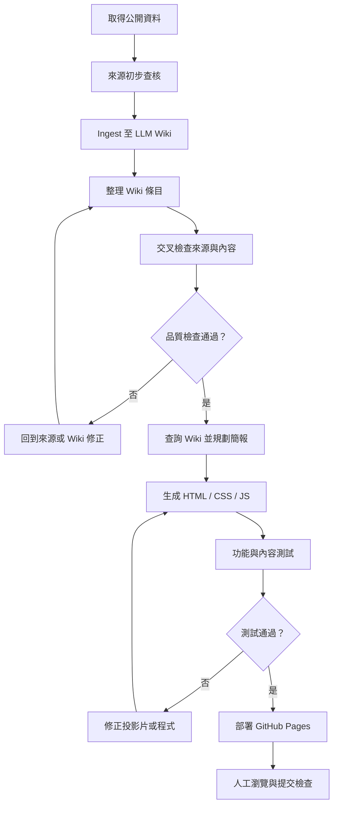

# Workflow / Loop / Graph 設計

## 流程圖

## 使用模型與版本紀錄
- AI 工具：Google Gemini CLI。
- 模型名稱／版本：**待實際執行時記錄**。Gemini CLI 可能依帳號、設定與當時服務提供不同模型，不應在未查證時預填。
- CLI 版本：執行 `gemini --version` 後填寫。
- 執行日期：待實際執行後填寫。
- 重要：本專案目前提供的是預先製作的 Wiki 與簡報初稿，並不代表已由 Gemini CLI 真正 Ingest 或生成。請依老師要求實際執行並保存對話截圖。

## Loop 設計
### Loop A：來源與 Wiki 品質迴圈
1. 取得來源。
2. 檢查來源權威性、日期及內容是否與研究問題相關。
3. 擷取摘要與支持的主張。
4. 更新 Wiki。
5. 檢查重複、矛盾與引用。
6. 未通過時回到來源查核或 Wiki 修正。

### Loop B：簡報生成與測試迴圈
1. 從 Wiki 擷取章節重點。
2. 生成投影片內容。
3. 產生 HTML、CSS、JavaScript。
4. 測試頁數、導覽、鍵盤、互動測驗及響應式版面。
5. 未通過時修正後重新測試。

## 哪些步驟會重複執行？
- 新增或更新來源時，重複執行來源查核、摘要、Wiki 更新及引用檢查。
- Wiki 內容有重大變更時，重複執行簡報內容整理與生成。
- HTML 功能或版面測試失敗時，重複執行修正與測試。
- GitHub Pages 部署後若發現路徑或資源錯誤，修正後重新部署。

## 哪些地方需要檢查或重新生成？
- Ingest 後：檢查資料是否讀取完整、摘要是否忠於原文。
- Wiki 編輯後：檢查來源支持度、重複內容、矛盾及日期。
- 簡報生成後：檢查是否只使用 Wiki 中可追溯的內容。
- 網頁測試時：檢查 25 張投影片、目錄、鍵盤操作、進度條、測驗與手機版顯示。
- 部署後：檢查公開網址、圖片／CSS／JS 路徑及瀏覽器顯示。

## 為什麼這樣設計？
採用品質閘門而非單向流水線，是因為來源或摘要錯誤會一路影響 Wiki 與簡報。把查核提前到內容生成之前，可以減少錯誤擴散；簡報完成後再測試互動功能，則可避免只有外觀而無法正常操作。
